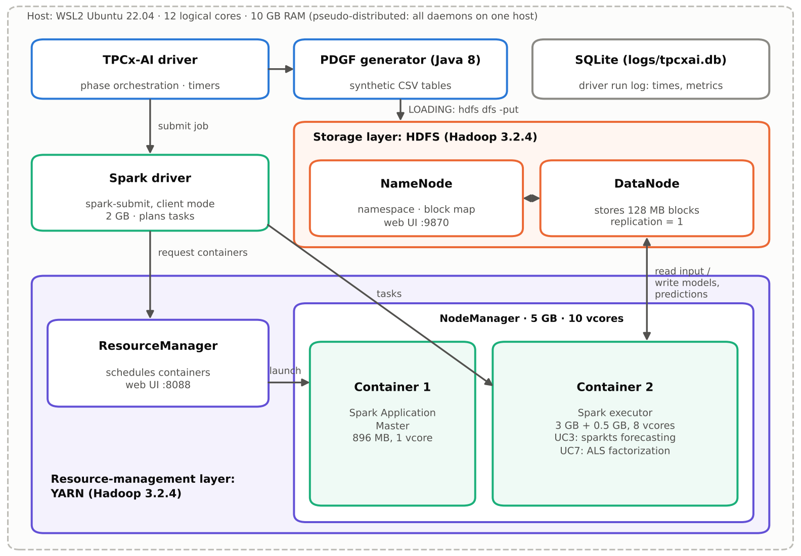

<div align="center">
  <h1>TPCx-AI on HDFS + YARN + Spark: Design, Build and Scalability Analysis</h1>
</div>

This repository contains the configuration, automation and analysis code for a **layered HDFS + YARN + Spark system** that runs the **TPCx-AI** benchmark's **Use Case 3 (sales forecasting)** and **Use Case 7 (product rating)**, and for the **scalability tests** that measure how the system behaves as the data size, the compute resources and the number of concurrent requests grow.

UC3 is a data-heavy workload: it joins tens of millions of LINEITEM rows with ORDER and PRODUCT and aggregates them into per-store, per-department weekly series before fitting a time-series model. UC7 is a model-iteration workload: it factorizes a small user–product rating table with ALS. Running both on one system exercises the storage and join path as well as iterative computation.

## System Design
- **Storage: HDFS 3.2.4** – NameNode + DataNode; inputs, models and predictions are shared through one distributed file system.
- **Resource management: YARN 3.2.4** – the ResourceManager schedules one ApplicationMaster and one executor container per Spark application; per-container memory and vcore limits isolate concurrent jobs.
- **Processing: Spark 3.0.3 on YARN** – the TPCx-AI reference Spark implementation (Scala 2.12) runs each use case and benchmark phase as a separate Spark application.
- **Orchestration: TPCx-AI v2.0.0 driver** – generates the data with PDGF, loads it into HDFS, runs training, serving, scoring and the serving-throughput test, and records phase times.
- **Pseudo-distributed deployment** – all daemons run on one WSL2 host (12 logical cores, 10 GB memory); the layout maps directly onto a multi-node cluster.

<div align="center">
  
</div>

## Repository Layout
```
config/
  hadoop/            core-site.xml, hdfs-site.xml, yarn-site.xml (YARN pool 5 GB / 10 vcores)
  spark/             spark-defaults.conf (event logs for the Spark History Server)
  tpcx-ai/           make_config.sh: derives the driver configuration from the kit's default-spark.yaml
  wslconfig.example  WSL2 memory settings (10 GB + 8 GB swap)
scripts/             install_configs.sh, start_cluster.sh, stop_cluster.sh
experiments/         run_one.sh (one monitored run), run_scalability.sh (experiments A, B, C)
analysis/            parse_results.py, spark_stages.py, plot.py
results/             summary tables and figures (raw/ holds per-run outputs)
```

## Getting Started

### Prerequisites
- Windows 11 + WSL2 Ubuntu 22.04 (or native Ubuntu 22.04), at least 16 GB RAM
- OpenJDK 8, Miniconda
- **TPCx-AI kit v2.0.0** – download it from the [TPC website](https://www.tpc.org/tpc_documents_current_versions/current_specifications5.asp). The kit is distributed under the TPC End-User License Agreement and is **not included** in this repository.

```sh
sudo apt update && sudo apt install -y openjdk-8-jdk unzip wget
sudo update-alternatives --config java          # select Java 8
```
On WSL2, copy `config/wslconfig.example` to `C:\Users\<you>\.wslconfig` and run `wsl --shutdown`.

### 1. Install the TPCx-AI kit (Spark implementation)
```sh
mkdir -p ~/spark-kit && cd ~/spark-kit
unzip -q /path/to/TPCX-AI-Tool.zip               # creates tpcx-ai-v2.0.0/
cd tpcx-ai-v2.0.0
bash setup-spark3.sh                             # driver environment in lib/python-venv
```

### 2. Install Hadoop 3.2.4 and Spark 3.0.3
```sh
mkdir -p ~/opt && cd ~/opt
wget https://repo.huaweicloud.com/apache/hadoop/common/hadoop-3.2.4/hadoop-3.2.4.tar.gz
wget https://repo.huaweicloud.com/apache/spark/spark-3.0.3/spark-3.0.3-bin-hadoop3.2.tgz
tar -xzf hadoop-3.2.4.tar.gz && tar -xzf spark-3.0.3-bin-hadoop3.2.tgz
cat >> ~/.bashrc <<'EOF'
export HADOOP_HOME=$HOME/opt/hadoop-3.2.4
export HADOOP_CONF_DIR=$HADOOP_HOME/etc/hadoop
export SPARK_HOME=$HOME/opt/spark-3.0.3-bin-hadoop3.2
export PATH=$HADOOP_HOME/bin:$HADOOP_HOME/sbin:$SPARK_HOME/bin:$SPARK_HOME/sbin:$PATH
EOF
source ~/.bashrc
```

### 3. Configure and start the cluster
```sh
git clone https://github.com/<your-id>/tpcx-ai-hdfs-yarn-spark.git && cd tpcx-ai-hdfs-yarn-spark
bash scripts/install_configs.sh
hdfs namenode -format                            # first install only
bash scripts/start_cluster.sh
```
Web UIs: HDFS `http://localhost:9870`, YARN `http://localhost:8088`, Spark History Server `http://localhost:18080`.

### 4. Verify Spark on YARN
```sh
spark-submit --master yarn --deploy-mode client --class org.apache.spark.examples.SparkPi \
  $SPARK_HOME/examples/jars/spark-examples_2.12-3.0.3.jar 10 2>&1 | grep "Pi is"
```
The first TPCx-AI run asks you to accept the PDGF license (type `YES`). Run one SF1 run by hand once (`bash experiments/run_one.sh test 1 8 2 1`) before starting the batch.

## Scalability Experiments

| Experiment | Varied | Fixed | Question |
|---|---|---|---|
| **A – data scalability** | scale factor 1, 3, 5, 10 | 1 executor × 8 cores × 3 GB, 2 streams | How do phase times grow with the input size, and where does the host saturate? |
| **B – resource scalability** | executor cores 1, 2, 4, 8 | SF 3, 2 streams | How much faster does training get with more cores (speedup, efficiency)? |
| **C – concurrency** | serving-throughput streams 1, 2, 4 | SF 3, 8 cores | How does YARN container sizing affect concurrent serving? |

```sh
bash experiments/run_scalability.sh all          # or A, B, C; REPS=3 by default, REPS_LARGE=2 for SF 10
```
Each run is written to `results/raw/<experiment>/sf<SF>_c<cores>_s<streams>_r<rep>/` with the kit's metric files, the console log, measured row counts, `vmstat` samples (5 s) and the run's Spark event logs. Finished runs are skipped, so an interrupted batch can simply be started again.

## Analysis
```sh
PY=~/spark-kit/tpcx-ai-v2.0.0/lib/python-venv/bin/python   # has pandas and matplotlib
$PY analysis/parse_results.py      # results/summary.csv   (one row per run)
$PY analysis/spark_stages.py       # results/spark_apps.csv, results/spark_top_stages.csv
$PY analysis/plot.py               # results/aggregate.csv, scaling_fit.csv, speedup.csv, figures/
```
- **Scaling fit** – training time is fitted as `time = fixed cost + cost per million rows × rows` over the scale factors, separating per-application overhead from data-proportional work.
- **Speedup / efficiency** – `T(1 core) / T(n cores)` and speedup divided by the core ratio.
- **Spark internals** – per application: task time, GC time, shuffle read/write and memory/disk spill; the three slowest stages of each application.

## Results
<!-- Fill in after running the experiments. -->
| Figure | File |
|---|---|
| Training and serving time vs input rows | `results/figures/A_time_vs_rows.png` |
| Training cost per million rows | `results/figures/A_cost_per_mrow.png` |
| CPU and swap vs scale factor | `results/figures/A_resources.png` |
| Speedup vs executor cores | `results/figures/B_speedup.png` |
| Time per serving stream | `results/figures/C_streams.png` |

## Troubleshooting
| Symptom | Fix |
|---|---|
| PDGF fails with `ClassCastException` | Use Java 8 (`sudo update-alternatives --config java`). |
| `CondaToSNonInteractiveError` during `setup-spark3.sh` | `conda tos accept --override-channels --channel https://repo.anaconda.com/pkgs/main` (and `.../pkgs/r`). |
| YARN: `requested resource is greater than maximum allowed allocation` | `yarn.scheduler.maximum-allocation-vcores` must be at least the executor cores (set to 10 here). |
| Runs are killed or the host freezes | Increase WSL memory (`.wslconfig`) or lower the scale factor. |

## License
The scripts and configuration files in this repository are released under the MIT License (see `LICENSE`). TPCx-AI and its benchmark kit are © Transaction Processing Performance Council and subject to the TPC EULA.
